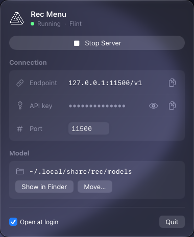
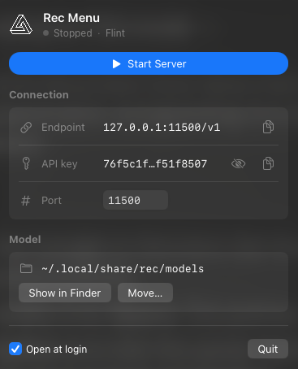
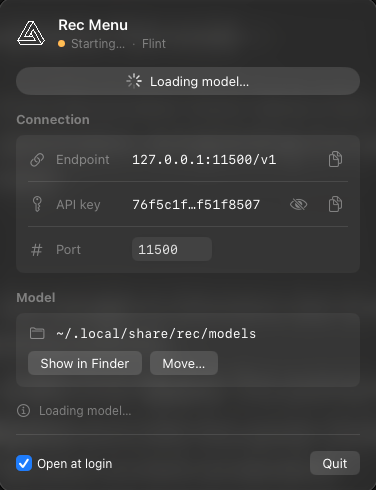
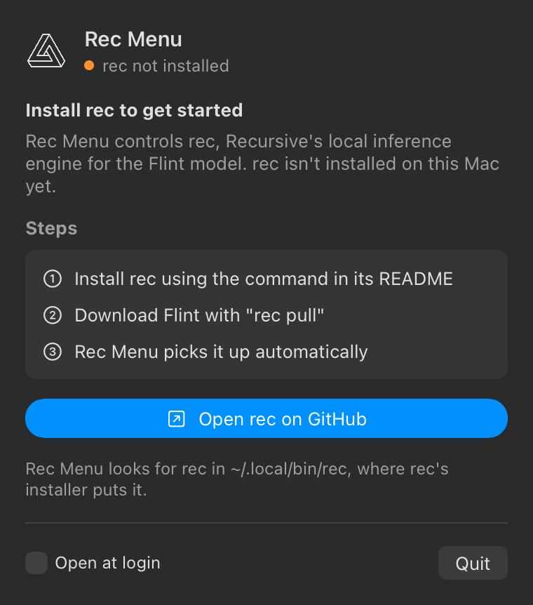

# Rec Menu

A small macOS menu bar app for [rec](https://github.com/recursive-oss/rec),
Recursive's local inference engine for its
[Flint](https://www.recursive.com/updates/introducing-recursive-flint) model.

<p align="center">
  
</p>

## TL;DR

- **What it is:** a menu bar app for Mac that controls `rec` without the
  terminal.
- **What it does:** starts and stops the Flint server, shows the API URL and
  key so you can copy them into your client, changes the port, and shows or
  moves where the model is stored. The menu bar icon turns green while the
  server runs.
- **How to use it:**
  1. Install [rec](https://github.com/recursive-oss/rec) and download Flint
     with `rec pull`.
  2. Download the DMG from the
     [latest release](https://github.com/Deepakanandrao/rec-menu/releases/latest)
     and drag **Rec Menu** into **Applications**.
  3. Click the triangle in the menu bar, then **Start Server**.
  4. Point your client at the endpoint with model `flint` and the API key from
     the panel.

> [!NOTE]
> Rec Menu is brand new, as are rec and Flint. Expect rough edges, and please
> [open an issue](https://github.com/Deepakanandrao/rec-menu/issues) if
> something doesn't work.

Rec Menu is for macOS only. It has been tested on a MacBook Pro with an M4 Pro
chip and 48 GB of memory.

Rec Menu is an independent project and is not affiliated with or endorsed by
Recursive. It does not include rec or the model; it controls the `rec` you
install yourself.

## Requirements

- A Mac with Apple Silicon that meets rec's requirements (M4 Pro, M5 Pro or
  M5 Max with at least 48 GB of memory)
- macOS 14 or later
- [rec](https://github.com/recursive-oss/rec) installed in `~/.local/bin/rec`
  (the default for rec's installer)

## Install

1. Download `RecMenu-<version>.dmg` from the
   [latest release](https://github.com/Deepakanandrao/rec-menu/releases/latest).
2. Open the DMG and drag **Rec Menu** into **Applications**.
3. Open Rec Menu from Applications. A triangle icon appears in the menu bar. It is
   green while the server runs, orange while it starts or stops, and plain
   when it is stopped.

Release builds are signed with a Developer ID (Huesion Inc., team
`W3QMF548W5`) and notarized by Apple, so they open without any security
prompts. Rec Menu lives only in the menu bar; it has no Dock icon or window.

The first time it runs from Applications, Rec Menu adds itself as a login item.
Turn this off with the **Open at login** checkbox in its panel.

### Uninstall

1. Turn off **Open at login** in the panel, then click **Quit**.
2. Move **Rec Menu** from Applications to the Trash.
3. Optionally, remove its saved settings:
   `defaults delete io.github.deepakanandrao.recmenu`

This leaves rec and the model in place; use `rec uninstall` to remove those.

## Usage

Click the menu bar icon:

- **Start / Stop** runs the server in the background, the same way
  `rec launch` does, so it keeps running if you quit Rec Menu.
- **Endpoint** shows the OpenAI-compatible API URL, for example
  `http://127.0.0.1:11500/v1`, with a button to copy it. Use model `flint`.
- **API key** is required by rec for every request. The eye button shows or
  hides it, and the copy button copies it.
- **Port** changes the port. If the server is running, it restarts on the new
  port.
- **Model location** shows where rec keeps the model. **Move…** moves it to
  a `rec-models` folder in a location you choose and leaves a symlink at
  `~/.local/share/rec/models`, so the `rec` command keeps working. **Reset**
  moves it back.

If you move the model, `rec uninstall` removes only the symlink; delete the
`rec-models` folder yourself.

### Server states

The status line under the title, and the color of the menu bar icon, show
what the server is doing.

| Stopped | Starting | Running |
|:---:|:---:|:---:|
|  |  |  |

### If rec isn't installed

When Rec Menu can't find rec at `~/.local/bin/rec`, it shows setup steps and a
link to rec's GitHub page instead of the controls. Once rec is installed, the
controls come back on their own.

<p align="center">
  
</p>

## Build from source

Requires the Xcode command line tools.

```bash
git clone https://github.com/Deepakanandrao/rec-menu.git
cd rec-menu
./build.sh            # builds "build/Rec Menu.app"
./build.sh --install  # also copies it to /Applications
./build.sh --dmg      # also packages build/RecMenu-<version>.dmg
```

To sign and notarize a release with an Apple Developer ID, set
`SIGN_IDENTITY` to your "Developer ID Application" identity and
`NOTARY_PROFILE` to a `notarytool` keychain profile before running
`./build.sh --dmg`.

## Contributing

Issues and pull requests are welcome. Pull requests from forks never run the
release workflow and never see its secrets.

To report a security problem, use
[private vulnerability reporting](https://github.com/Deepakanandrao/rec-menu/security/advisories/new)
instead of a public issue.

## Releasing

Only the maintainer can release: a ruleset limits creating, moving and
deleting `v*` tags to repository admins.

1. Update `VERSION`.
2. Commit, then tag and push: `git tag v1.0.0 && git push origin v1.0.0`.
3. The release workflow builds the DMG, signs it with the Developer ID,
   notarizes it with Apple and attaches it to a GitHub release.

To test signing without publishing, run the workflow by hand from the
**Actions** tab; it keeps the DMG as a downloadable artifact.

The workflow reads these secrets from the `release` environment, which only
`v*` tags and `main` can use:

| Secret | Value |
|---|---|
| `MACOS_CERT_P12` | The Developer ID Application certificate and private key, exported as `.p12` and base64-encoded |
| `MACOS_CERT_PASSWORD` | The password set when exporting the `.p12` |
| `NOTARY_KEY_P8` | Contents of an App Store Connect API key (`.p8`) |
| `NOTARY_KEY_ID` | That key's Key ID |
| `NOTARY_ISSUER_ID` | The Issuer ID shown above the keys list in App Store Connect |

## License

[Apache License 2.0](LICENSE). See [NOTICE](NOTICE).
